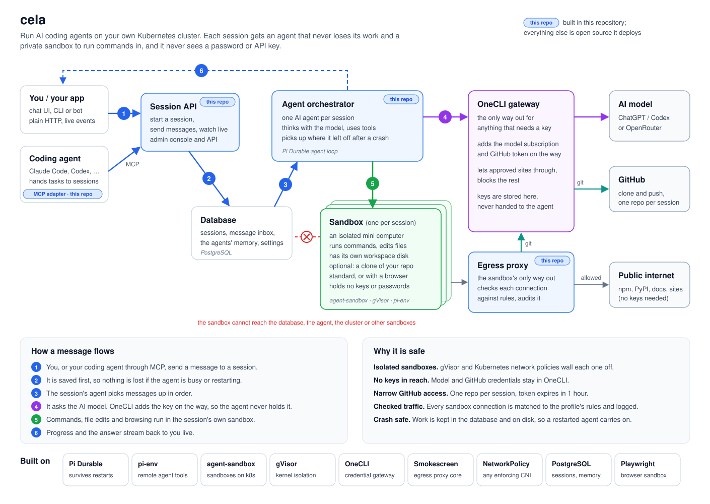

# pi-durable-k8s

Run [Pi Durable](https://github.com/earendil-works/pi) coding agents on your own Kubernetes cluster.

Each session gets an agent that keeps its state in PostgreSQL and resumes after a crash, plus a private gVisor
sandbox with a persistent workspace where its tools run. Model and GitHub credentials never reach the agent or the
sandbox: [OneCLI](https://github.com/onecli/onecli) injects them at its gateway.

**Status: proof of concept.** It runs end to end on a small arm64 lab cluster. It is not hardened for production;
see the open items in [plan.md](plan.md).



## How it works

1. A client creates a session and posts messages to the **session API** (`packages/ingest`).
2. Messages land in an inbox in **PostgreSQL** first, so nothing is lost while the agent is busy or restarting.
3. The **orchestrator** (`packages/orchestrator`) runs one durable Pi agent loop per session and takes inbox
   messages in order.
4. Model calls go through the **OneCLI gateway**, which adds the subscription or API key on the way out.
5. Tool calls (bash, read, write, edit) run in the session's **sandbox**: a pod from
   [agent-sandbox](https://github.com/kubernetes-sigs/agent-sandbox) under gVisor, with the `pi-env` daemon inside.
   It is created on the first tool call and keeps its workspace on a PVC.
6. Progress and answers stream back to the client over SSE.

Optionally a session works on one GitHub repository: the orchestrator mints a token scoped to that repository,
stores it in OneCLI for that session only, and the sandbox clones and pushes through the gateway.

## Security model

- Sandboxes run under gVisor. Network policies (written for Cilium) block sandboxes from the orchestrator, the
  database, the Kubernetes API, OneCLI's management API and each other.
- Each sandbox's daemon accepts only its own token, derived from a master key the orchestrator holds
  ([ADR 0001](docs/decisions/0001-per-sandbox-sandboxd-token.md)).
- No credentials in sandboxes or in the agent: OneCLI holds them and only relays to allowlisted hosts
  ([host rules](docs/onecli-host-rules.md)).

## Repository layout

| Path                                   | What                                                                                                 |
| -------------------------------------- | ---------------------------------------------------------------------------------------------------- |
| `packages/ingest`                      | Session API: auth, owner checks, inbox writes, SSE proxy                                             |
| `packages/orchestrator`                | Pi Durable harness, sandbox lifecycle, model and OneCLI wiring                                       |
| `packages/sandbox-env`                 | Bridge from Pi's `RemoteExecutionEnv` to an agent-sandbox pod (the only SDK user)                    |
| `packages/session-core`                | Shared schema, migrations and auth helpers                                                           |
| `packages/vendor/agent-sandbox-client` | Vendored, pinned agent-sandbox TypeScript SDK (Apache-2.0)                                           |
| `vendor/`                              | Packed `@netzlabor/pi-durable-postgres` adapter, ported to Pi Durable 1.5.2                          |
| `images/sandbox`                       | Sandbox image: sandboxd + `pi-env` + git                                                             |
| `deploy/`                              | Kubernetes manifests (namespace, Postgres, orchestrator, ingest, sandbox template, network policies) |
| `tests/e2e`                            | End-to-end suites that run as in-cluster Jobs                                                        |
| `docs/`                                | API, credentials, networking, decisions and research notes                                           |

## Docs

- [Session API](docs/session-api.md)
- [Model credentials through OneCLI](docs/model-credentials.md)
- [Repository workspaces](docs/repo-workspace.md)
- [Network policy](docs/network-policy.md) and [OneCLI host rules](docs/onecli-host-rules.md)
- [Plan, decisions and phase results](plan.md)

## Development

Requires Node 22.19+ and pnpm.

```sh
pnpm install
pnpm check        # build, lint, format, typecheck, unit tests
tests/e2e/run.sh smoke   # needs a cluster with agent-sandbox, gVisor and the deploy/ manifests applied
```

## License

MIT, see [LICENSE](LICENSE). The vendored agent-sandbox SDK in `packages/vendor/agent-sandbox-client` keeps its Apache-2.0 license.
