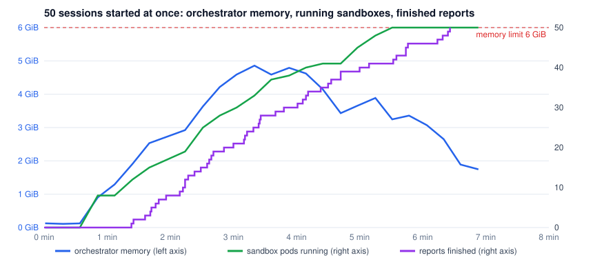

# Historical lab notes

Historical delivery findings below use descriptive `retired-*` names for tooling removed by installation slice 2; they are not current deploy commands.


These are dated observations from **one example arm64 test environment**, not deployment prerequisites or a runbook.
Measured numbers and findings are retained for comparison; they are not capacity guarantees. Use the current
[deploy guide](../deploy/README.md) and [e2e suites](e2e.md) on your own cluster.
Raw transcripts, resource logs and failed-start logs were dropped: they duplicated old source and cluster state.
The summaries below retain their measured results.

## Policy enforcement observation

On 2026-11-16, after applying OneCLI ingress/egress policies, dashboard HTTP status was 200 and real-model,
repository and isolation suites passed. `cilium-dbg monitor --type drop` on the OneCLI endpoint saw **0 drops**
over those runs. An interactive dashboard login was not covered. This is one environment, not a claim about other clusters.

## bug-hunt-2026-11-16

### Five AI agents hunt bugs in their own platform

A live run on 2026-11-16: five durable Pi agent sessions, each in its own gVisor sandbox with a fresh clone of this
repository, reviewed one area of pi-durable-k8s for bugs. The platform they ran on is the code they reviewed.

Everything here is real output. Nothing was edited except the summaries in this file.

### Setup

|          |                                                                                                                                |
| -------- | ------------------------------------------------------------------------------------------------------------------------------ |
| Cluster  | a small arm64 lab cluster (Kubernetes, Cilium, gVisor), not a cloud                                                            |
| Sessions | 5, created through the session API with `{ provider: "openai-codex", model: "gpt-6.1-terra", repo: "owner/repo" }` |
| Model    | GPT 6.1 terra, reasoning `medium`, through a ChatGPT/Codex subscription injected by OneCLI                                     |
| Sandbox  | one gVisor pod per session (250m CPU, 256 MiB), workspace PVC, the repo cloned with a token scoped to this one repository      |
| Tools    | Pi's coding tools (bash, read, write, edit), running inside the sandbox                                                        |
| Limits   | static review only: the sandbox image has no Node, so the agents could not run the tests                                       |

Each session got one area and the same rules ([briefs/](../examples/bug-hunt-2026-11-16/briefs/)):

1. Orchestrator inbox and turn processing
2. Sandbox lifecycle (orphan sweep, pod recycle, idle suspend)
3. The bridge between Pi and the sandbox
4. Session API and auth
5. Kubernetes manifests and shell scripts

The rules ask for real defects only, re-checked before reporting, at most about 40 tool calls, and a fixed Markdown
report ending in `END-OF-REPORT`.

### What happened (timeline)

From the orchestrator log (raw/orchestrator.log (log omitted)) and the runner's timeline
(raw/timeline.log (log omitted)), all times UTC:

| Step                                          | Sessions 1 and 2 | Sessions 3 to 5              |
| --------------------------------------------- | ---------------- | ---------------------------- |
| Session created, message posted               | 11:07:59         | 11:12:36 to 11:12:42         |
| Sandbox ready (claim to running pod)          | +18 s            | +19 s                        |
| Repo token minted, OneCLI agent provisioned   | +66 s            | +21 to +30 s                 |
| `git clone` done, message handed to the agent | +96 s            | +31 to +41 s                 |
| Report finished                               | before 11:12:43  | +42 to +49 s after hand-over |

The agents were fast: 5 to 8 tool calls each, usually one large `bash` that printed several files at once, then
the report. The slow part was workspace setup, not the review.

Sessions 1 and 2 were slower because the platform was misbehaving at the time (next section).

### Bugs the run found before the agents did

Two problems showed up only because real sessions ran. No agent reported them.

1. **The first five sessions used the test model.** Ingest reads the default model from a ConfigMap into environment
   variables. The e2e test overlay had set it to a scripted test model. Putting the ConfigMap back did nothing for pods
   already running, so `POST /sessions` still defaulted to the test model until ingest was restarted. Those sessions
   were deleted (false-start/ (log omitted)). The runner now names the model explicitly.
2. **Ingest crash-looped while repo sessions started.**
   - The orchestrator keeps a database transaction open while it prepares a session's workspace: sandbox, OneCLI
     agent, `git clone`. Here that took 96 s.
   - At start, ingest re-ran its schema migrations, including `ALTER TABLE`. Those waited behind that transaction,
     hit the 30 s statement timeout, and blocked every insert queued behind them.
   - Ingest only starts its HTTP server after migrating, so `/healthz` did not answer and the liveness probe killed
     the pod, over and over.

   The fix ([gscode1/pi-durable-k8s#4](https://github.com/gscode1/pi-durable-k8s/pull/4)) records applied migrations
   and runs no DDL when the schema is current. It also uses a short `lock_timeout` when a migration does run, and
   serves `/healthz` before migrating. ADR 0005 has the details.

   Re-test after the fix: I restarted ingest while a repo session was cloning. Both new pods listened
   at once, finished the migration check in 0.3 s (nothing to apply) and stayed up with 0 restarts. The session
   finished normally.

A smaller operator lesson: my first runner ran five stream clients inside the 256 MiB ingest container, which likely
caused the first ingest restart. The second runner ([run-hunt2.sh](../examples/bug-hunt-2026-11-16/run-hunt2.sh), [multi-stream.mjs](../examples/bug-hunt-2026-11-16/multi-stream.mjs))
follows all sessions from one small process and resumes with `Last-Event-ID`.

### What the agents found

19 findings in 5 reports ([reports/](../examples/bug-hunt-2026-11-16/reports/)). An agent's report is not proof, so every finding was re-checked
against the code by an independent verifier agent told to try to refute it ([verified/](../examples/bug-hunt-2026-11-16/verified/)), and the
important ones were spot-checked by hand.

| Area      | Finding                                                           | Agent said | Verdict      | Verified severity |
| --------- | ----------------------------------------------------------------- | ---------- | ------------ | ----------------- |
| inbox     | Batch with a later delete stalls 30 s on its own row lock         | high       | confirmed    | medium            |
| inbox     | A failed session's abort is never retried                         | high       | confirmed    | medium            |
| inbox     | Watch recovery only covers 24 h / 1000 submissions                | medium     | plausible    | low               |
| inbox     | SSE backpressure leaks `close` listeners                          | medium     | confirmed    | low               |
| lifecycle | Orphan sweep can delete a live claim or PVC                       | high       | **rejected** | n/a               |
| lifecycle | Repo preparation bypasses idle tracking                           | high       | confirmed    | medium            |
| lifecycle | Failed pod recycle lets calls into a dirty sandbox                | high       | confirmed    | medium            |
| lifecycle | Clearing the in-flight marker races the next command              | medium     | plausible    | low               |
| lifecycle | Non-canonical names (`pi-conv-01`) map to another session         | high       | plausible    | low               |
| bridge    | Bridge ignores stdout backpressure                                | high       | plausible    | low               |
| bridge    | Closing a connection that waits for the start gate blocks it 45 s | medium     | confirmed    | medium            |
| bridge    | stdout error during the final flush reported as success           | medium     | plausible    | low               |
| API       | A client-chosen `sourceEventId` can block deletion                | high       | confirmed    | medium            |
| API       | An event can be accepted while the session is being deleted       | medium     | confirmed    | low               |
| API       | A delete that fails 5 times in a few seconds can never be retried | high       | confirmed    | **high**          |
| deploy    | `retired-orchestrator-delivery` can leave the orchestrator scaled to 0             | high       | confirmed    | medium            |
| deploy    | Secret scripts pass values on the kubectl command line            | high       | confirmed    | low               |
| deploy    | A failed host-rules update leaves the OneCLI allowlist off        | high       | confirmed    | medium            |
| deploy    | Test cleanup deletes rows before resources are gone               | medium     | confirmed    | low               |

Totals: **12 confirmed, 6 plausible, 1 rejected.** The agents rated 12 findings high. After verification, one is high,
8 are medium and the rest are low or rejected.

Notes on the results:

- **Precision was good, severity was not.** Almost everything pointed at a real mechanism, but the agents
  consistently rated their findings too severe. The verifier usually lowered the rating because of a mitigation the
  agent never read: a statement timeout that turns a "deadlock" into a 30 s stall, a second firewall layer, or a
  trigger that needs hand-made resources.
- **The one rejection was well reasoned but wrong.** The sweep cannot race a new claim, because claim names come from
  conversation ids, and those are never reused.
- **The most useful finding** was the delete retry: five attempts about one second apart, then the delete is marked
  failed for good, and a second `DELETE` is deduplicated away. A Kubernetes API hiccup of a few seconds leaves a
  session stuck in `deleting` with its sandbox, PVC and OneCLI agent alive, and the orphan sweep treats `deleting` as
  live.

### Fixes

All 12 confirmed findings were fixed the same day. Each fix was written by an implementation agent with a unit test
that fails without it, then run on the lab cluster (phase 4: 15 e2e tests, phase 4c: repo sessions) before merging.

| PR                                                       | Fixes                                                                                                                                                                                                                                                                                                    |
| -------------------------------------------------------- | -------------------------------------------------------------------------------------------------------------------------------------------------------------------------------------------------------------------------------------------------------------------------------------------------------- |
| [#21](https://github.com/gscode1/pi-durable-k8s/pull/21) | Deletes retry with backoff until done, and a repeated `DELETE` re-queues a failed one (the high one). The server's delete key can no longer be taken by a client id. Event admission is one conditional insert. No session-row update inside the batch transaction. A failed session's abort is retried. |
| [#15](https://github.com/gscode1/pi-durable-k8s/pull/15) | Repo clones go through the tracked sandbox env. A failed pod recycle is retried before the next call, never skipped. A closed connection gives up its start-gate turn. SSE backpressure removes its listeners.                                                                                           |
| [#17](https://github.com/gscode1/pi-durable-k8s/pull/17) | `retired-orchestrator-delivery` always scales back and swaps code only after a good extract. Secret scripts pass values through private files, not argv. Host-rules update creates allow rules before touching the block rule and restores it on failure. Test cleanup only drops rows of deleted sessions.               |

Checked live after #21: a message using the id `delete:<session>` followed by `DELETE` reached `deleted` in 3 s. A
message and a delete sent back to back finished in 3 s with no statement timeout. An event posted after the delete got
`410`.

The 6 plausible findings are not fixed: their triggers need hand-made resources, a parent process that stalls for a
long time, or more than 24 h of unsettled runs.

Found along the way, not by the hunt:

- [#4](https://github.com/gscode1/pi-durable-k8s/pull/4): the ingest crash loop described above.
- [#6](https://github.com/gscode1/pi-durable-k8s/pull/6): the public-release cleanup had broken the e2e entry point for
  an empty `KUBE_CONTEXT`.
- [#22](https://github.com/gscode1/pi-durable-k8s/pull/22): two flaky unit tests, 5 failures in 36 full-suite runs
  before, 0 in 24 after. One was a test deleting a directory while a Host still wrote to it. The other was a real
  nondeterministic error message.

### Resources

From raw/resources.log (log omitted), sampled every 20 s:

| State                           | Orchestrator memory   |
| ------------------------------- | --------------------- |
| Idle                            | about 110 MiB         |
| 2 sessions with open bridges    | about 420 MiB         |
| 3 sessions with open bridges    | about 550 to 600 MiB  |
| Bridges closed after 2 min idle | back to about 116 MiB |

Each open session costs about 150 MiB in the orchestrator, because each one runs its own Node bridge process. That is
why the orchestrator was OOM-killed at 1 GiB in an earlier test run, and why a shared in-process broker is next on
the list.

Cleanup after `DELETE /sessions/{id}` for all five, measured: claims gone after 4 s; PVCs, sandbox pods and the five
per-session OneCLI agents gone after 11 s.

### Reproduce

```sh
# needs an adapted test stack, an owner token in the ingest pods, and a reachable model
REPO=owner/repo NAMESPACE=pi-durable-poc examples/bug-hunt-2026-11-16/run-hunt2.sh      # creates the missing sessions, follows them, writes raw/
```

### Files

| Path                                              | What                                                                                           |
| ------------------------------------------------- | ---------------------------------------------------------------------------------------------- |
| [briefs/](../examples/bug-hunt-2026-11-16/briefs/)                                | The prompt: one area per session plus the common rules                                         |
| [reports/](../examples/bug-hunt-2026-11-16/reports/)                              | Each agent's final report, verbatim                                                            |
| [verified/](../examples/bug-hunt-2026-11-16/verified/)                            | The verifier's verdict per finding                                                             |
| `run-hunt.sh`, `run-hunt2.sh`, `multi-stream.mjs` | The runners                                                                                    |


## load-50-2026-11-16

### 50 agents at once: a load test that is also a bug hunt

A live run on 2026-11-16, a few hours after the [five-session bug hunt](../examples/load-50-2026-11-16/../bug-hunt-2026-11-16/) and its fixes.
50 durable Pi sessions were created in one burst. Each got its own gVisor sandbox, a clone of this repository, and
one source file to review. The question was not only "what do they find" but "what does the platform do under load".



### Setup

|              |                                                                                                                                                         |
| ------------ | ------------------------------------------------------------------------------------------------------------------------------------------------------- |
| Cluster      | 3 arm64 nodes (8 cores each; 32, 32 and 16 GiB), Cilium, gVisor, Longhorn. Other workloads kept running.                                                |
| Sessions     | 50, all created in one `Promise.all` from inside an ingest pod ([create-all.mjs](../examples/load-50-2026-11-16/create-all.mjs))                                                       |
| Model        | GPT 6.1 terra, reasoning `medium`, one ChatGPT/Codex subscription through OneCLI                                                                        |
| Work         | one file each: the 50 largest source and script files of the repo ([files.txt](../examples/load-50-2026-11-16/files.txt)), same rules for all ([common.md](../examples/load-50-2026-11-16/common.md))                 |
| Orchestrator | 1 replica, memory limit raised from 2 GiB to 6 GiB for this test, at most 8 sessions prepared in parallel                                               |
| Safety       | the runner deletes every session if a node reports pressure or pods outside this namespace turn unhealthy ([run-load.sh](../examples/load-50-2026-11-16/run-load.sh)). It never fired. |

### Results

| Measure                                                     | Result                                                                                            |
| ----------------------------------------------------------- | ------------------------------------------------------------------------------------------------- |
| 50 sessions created and messages posted                     | in 5 s, 0 errors (create p50 1.9 s, max 2.8 s)                                                    |
| All 50 sandbox pods running                                 | after 5.5 min                                                                                     |
| All 50 reports finished                                     | after 6 min 26 s                                                                                  |
| Burst to report, per session                                | min 83 s, p50 204 s, p90 346 s, max 386 s                                                         |
| Waiting for the workspace (sandbox, OneCLI agent, clone)    | min 47 s, p50 172 s, p90 314 s, max 347 s                                                         |
| Actual agent work                                           | min 17 s, p50 36 s, p90 50 s, max 64 s; 3 to 11 tool calls, 309 in total                          |
| Orchestrator memory                                         | about 110 MiB idle, peak 4.9 GiB                                                                  |
| Failed inbox events, ingest restarts, orchestrator restarts | 0, 0, 0                                                                                           |
| Model rate limits (HTTP 429)                                | 0                                                                                                 |
| Node pressure, unhealthy pods elsewhere                     | none                                                                                              |
| `DELETE` all 50 at once                                     | claims gone in 33 s, PVCs and pods in 36 s, every session `deleted` in 43 s, 0 OneCLI agents left |

What the numbers say:

- **Setup is the bottleneck, not the agents.** A session waited p50 172 s for its workspace and then needed 36 s
  for the review. The orchestrator prepares at most 8 sessions in parallel, and each needs a pod, a Longhorn volume,
  a OneCLI agent with narrowed grants, and a `git clone`.
- **Memory follows open bridges, not sessions.** Each session that has an open bridge to its sandbox costs about
  100 MiB in the orchestrator, because each bridge is its own Node process. Bridges close after 2 minutes idle, so
  memory peaked at 4.9 GiB while sandboxes were still starting and fell as reports finished. A shared in-process
  broker is the fix for running 100 sessions within a few GiB.
- **OneCLI is the weak spot under concurrency.** It answered HTTP 500 on grant changes during setup, and HTTP 409 or
  500 on agent deletes, 28 times in all (raw/orchestrator.log (log omitted)). Every one was retried and
  succeeded. Before the delete fix earlier that day (5 attempts in about 5 s, then failed for good), several of
  those sessions would have stayed in `deleting` with their sandbox and OneCLI agent alive.
- **The cluster did not notice much.** 50 extra pods and 50 Longhorn volumes (26 to 76) came and went without node
  pressure or trouble for other workloads.

### What the agents found

83 findings in 44 of the 50 reports ([reports/](../examples/load-50-2026-11-16/reports/)). Six files had none. Every finding was checked by an
independent verifier agent told to refute it ([verified/](../examples/load-50-2026-11-16/verified/)). Two medium ones were also checked by hand:
GitHub's secondary rate limit returns 403, which is treated as a permanent denial; and a failed grant check replaces
the OneCLI agent while the open sandbox keeps the old token.

|           | Agents said | After verification |
| --------- | ----------- | ------------------ |
| Confirmed |             | 46                 |
| Plausible |             | 34                 |
| Rejected  |             | 3                  |
| High      | 22          | 0                  |
| Medium    | 45          | 13                 |
| Low       | 16          | 67                 |

Same pattern as the five-session hunt, only stronger:

- **The mechanisms are mostly real.** 96% were confirmed or plausible. The three rejections were checked
  empirically (a JS regex, a Node HTTP behaviour, a sequential probe loop).
- **Severity is systematically inflated.** Not one of the 22 "high" findings held up as high. The usual reasons are a
  mitigation the agent did not read, a trigger that needs a crash in a narrow window, or test-only code.
- **One file per agent finds a different class of bug.** The five-area hunt found cross-cutting races. This one found
  local defects: error mapping, validation gaps, test assertions that never assert, and a few duplicates across
  neighbouring files.

Medium findings after verification:

| #       | Finding                                                                                  | Verdict   | Location                                          | Fixed in  |
| ------- | ---------------------------------------------------------------------------------------- | --------- | ------------------------------------------------- | --------- |
| 08      | A failed grant check replaces the OneCLI agent, but the open sandbox keeps the old token | confirmed | `packages/orchestrator/src/repo-access.ts:156`    | #33       |
| 11      | Credential-leak checks in the repo e2e test do not assert their results                  | confirmed | `tests/e2e/run-phase4c.sh:177`                    | #31       |
| 12      | Unknown grant categories are silently ignored                                            | plausible | `packages/orchestrator/src/onecli-admin.ts:97`    | not fixed |
| 14      | Log polling can keep the e2e entry point from returning a verdict                        | confirmed | `tests/e2e/run.sh:156`                            | #31       |
| 17      | Filesystem errors are treated as a lost workspace                                        | confirmed | `packages/orchestrator/src/workspace.ts:64`       | #33       |
| 22 / 29 | A stale session snapshot in the sweep can revoke a live session's credentials            | plausible | `packages/orchestrator/src/sweep.ts:128`          | #33       |
| 23      | A GitHub rate limit (403) permanently fails a session                                    | confirmed | `packages/orchestrator/src/github-app.ts:104`     | #33       |
| 30      | A lost DELETE response can leave the OneCLI gateway without its block rule               | plausible | `deploy/onecli-host-rules.sh:84`                  | not fixed |
| 32      | A bridge could read the launcher's master key through `/proc`                            | plausible | `packages/orchestrator/src/bridge-launcher.ts:72` | #34       |
| 34      | Two concurrent code pushes interfere                                                     | confirmed | `deploy/retired-orchestrator-delivery:21`                          | #31       |
| 37      | A failed bridge start delays unrelated sandboxes                                         | confirmed | `packages/sandbox-env/src/index.ts:51`            | #34       |
| 38      | Removing a provider from the allowlist breaks existing conversations                     | confirmed | `packages/orchestrator/src/providers.ts:44`       | #34       |

### Fixes

All 46 confirmed findings were fixed the same day, plus the plausible ones whose fix was small (for example the
`/proc` master-key read and the sweep's stale snapshot). Each fix in code has a unit test that failed before it.

| PR                                                       | Area                                                                                                                                         |
| -------------------------------------------------------- | -------------------------------------------------------------------------------------------------------------------------------------------- |
| [#31](https://github.com/gscode1/pi-durable-k8s/pull/31) | e2e tests and deploy scripts: assertions that never asserted, cleanup traps, a lock against concurrent code pushes, reproducible ingest tars |
| [#32](https://github.com/gscode1/pi-durable-k8s/pull/32) | Input validation: model pairs, `.lock` branch names, tokens with whitespace, NUL characters, ingest config                                   |
| [#33](https://github.com/gscode1/pi-durable-k8s/pull/33) | Lifecycle: atomic delete start, OneCLI agent kept on transient errors, sweep order, GitHub rate limits retried instead of failing a session  |
| [#34](https://github.com/gscode1/pi-durable-k8s/pull/34) | Orchestrator and bridge: streams during delete, no launcher process holding the master key, start gate freed on bridge failure               |

The four PRs were merged into one branch and run on the lab cluster before merging: phase 4 (15 tests), phase 4b with
the real model, phase 4c (repo sessions) and phase 3 (sandbox loss, isolation, restart, double owner, long command)
all passed. Then three checks by hand on a live session:

- The bridge process's environment holds only its own sandbox token, derived from the claim name. No master key,
  database URL or API tokens.
- Neither that token nor the master key appears in the orchestrator log.
- A stream open during `DELETE` got `event: deleted` and closed after 0.3 s. A new stream on the session got `410`.

The two medium findings left open are plausible, not confirmed: an unknown OneCLI grant category (12) and a lost
`DELETE` response in the host-rules script (30).

### Reproduce

```sh
# a cluster set up from deploy/, an owner token in the ingest pods, a reachable model
REPO=owner/repo NAMESPACE=pi-durable-poc examples/load-50-2026-11-16/run-load.sh
```

`create-all.mjs` embeds the 50 briefs. Regenerate it from `files.txt` and `common.md` to point it at other files.

### Files

| Path                                                                       | What                                                                                          |
| -------------------------------------------------------------------------- | --------------------------------------------------------------------------------------------- |
| [load.svg](../examples/load-50-2026-11-16/load.svg)                                                       | Memory, running sandboxes and finished reports over time, from `raw/resources.log`            |
| [files.txt](../examples/load-50-2026-11-16/files.txt), [common.md](../examples/load-50-2026-11-16/common.md), [briefs.json](../examples/load-50-2026-11-16/briefs.json) | What each session was asked                                                                   |
| [reports/](../examples/load-50-2026-11-16/reports/)                                                       | Each agent's final report, verbatim                                                           |
| [verified/](../examples/load-50-2026-11-16/verified/)                                                     | The verifier's verdict per finding                                                            |
| `run-load.sh`, `create-all.mjs`, `multi-stream.mjs`                        | The runner                                                                                    |
