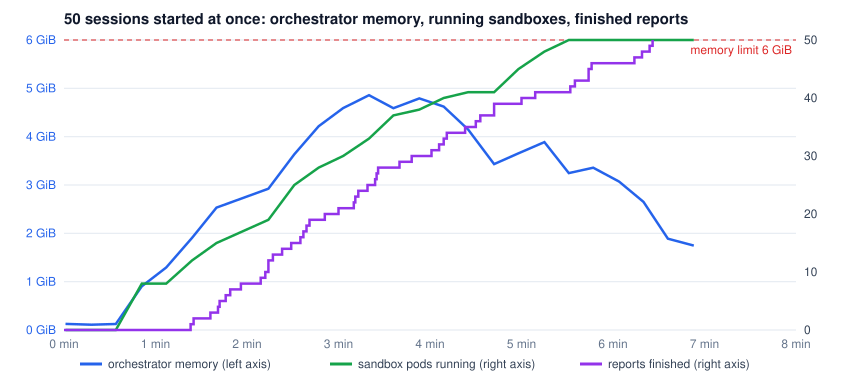

# 50 agents at once: a load test that is also a bug hunt

A live run on 2026-11-16, a few hours after the [five-session bug hunt](../bug-hunt-2026-11-16/) and its fixes.
50 durable Pi sessions were created in one burst. Each got its own gVisor sandbox, a clone of this repository, and
one source file to review. The question was not only "what do they find" but "what does the platform do under load".



## Setup

|              |                                                                                                                                                         |
| ------------ | ------------------------------------------------------------------------------------------------------------------------------------------------------- |
| Cluster      | 3 arm64 nodes (8 cores each; 32, 32 and 16 GiB), Cilium, gVisor, Longhorn. Other workloads kept running.                                                |
| Sessions     | 50, all created in one `Promise.all` from inside an ingest pod ([create-all.mjs](create-all.mjs))                                                       |
| Model        | GPT 6.1 terra, reasoning `medium`, one ChatGPT/Codex subscription through OneCLI                                                                        |
| Work         | one file each: the 50 largest source and script files of the repo ([files.txt](files.txt)), same rules for all ([common.md](common.md))                 |
| Orchestrator | 1 replica, memory limit raised from 2 GiB to 6 GiB for this test, at most 8 sessions prepared in parallel                                               |
| Safety       | the runner deletes every session if a node reports pressure or pods outside this namespace turn unhealthy ([run-load.sh](run-load.sh)). It never fired. |

## Results

| Measure                                                     | Result                                                                                            |
| ----------------------------------------------------------- | ------------------------------------------------------------------------------------------------- |
| 50 sessions created and messages posted                     | in 5 s, 0 errors (create p50 1.9 s, max 2.8 s)                                                    |
| All 50 sandbox pods running                                 | after 5.5 min                                                                                     |
| All 50 reports finished                                     | after 6 min 26 s                                                                                  |
| Burst to report, per session                                | min 83 s, p50 204 s, p90 346 s, max 386 s                                                         |
| Waiting for the workspace (sandbox, OneCLI agent, clone)    | min 47 s, p50 172 s, p90 314 s, max 347 s                                                         |
| Actual agent work                                           | min 17 s, p50 36 s, p90 50 s, max 64 s; 3 to 11 tool calls, 309 in total                          |
| Orchestrator memory                                         | about 110 MiB idle, peak 4.9 GiB                                                                  |
| Failed inbox events, ingest restarts, orchestrator restarts | 0, 0, 0                                                                                           |
| Model rate limits (HTTP 429)                                | 0                                                                                                 |
| Node pressure, unhealthy pods elsewhere                     | none                                                                                              |
| `DELETE` all 50 at once                                     | claims gone in 33 s, PVCs and pods in 36 s, every session `deleted` in 43 s, 0 OneCLI agents left |

What the numbers say:

- **Setup is the bottleneck, not the agents.** A session waited p50 172 s for its workspace and then needed 36 s
  for the review. The orchestrator prepares at most 8 sessions in parallel, and each needs a pod, a Longhorn volume,
  a OneCLI agent with narrowed grants, and a `git clone`.
- **Memory follows open bridges, not sessions.** Each session that has an open bridge to its sandbox costs about
  100 MiB in the orchestrator, because each bridge is its own Node process. Bridges close after 2 minutes idle, so
  memory peaked at 4.9 GiB while sandboxes were still starting and fell as reports finished. A shared in-process
  broker is the fix for running 100 sessions within a few GiB.
- **OneCLI is the weak spot under concurrency.** It answered HTTP 500 on grant changes during setup, and HTTP 409 or
  500 on agent deletes, 28 times in all ([raw/orchestrator.log](raw/orchestrator.log)). Every one was retried and
  succeeded. Before the delete fix earlier that day (5 attempts in about 5 s, then failed for good), several of
  those sessions would have stayed in `deleting` with their sandbox and OneCLI agent alive.
- **The cluster did not notice much.** 50 extra pods and 50 Longhorn volumes (26 to 76) came and went without node
  pressure or trouble for other workloads.

## What the agents found

83 findings in 44 of the 50 reports ([reports/](reports/)). Six files had none. Every finding was checked by an
independent verifier agent told to refute it ([verified/](verified/)). Two medium ones were also checked by hand:
GitHub's secondary rate limit returns 403, which is treated as a permanent denial; and a failed grant check replaces
the OneCLI agent while the open sandbox keeps the old token.

|           | Agents said | After verification |
| --------- | ----------- | ------------------ |
| Confirmed |             | 46                 |
| Plausible |             | 34                 |
| Rejected  |             | 3                  |
| High      | 22          | 0                  |
| Medium    | 45          | 13                 |
| Low       | 16          | 67                 |

Same pattern as the five-session hunt, only stronger:

- **The mechanisms are mostly real.** 96% were confirmed or plausible. The three rejections were checked
  empirically (a JS regex, a Node HTTP behaviour, a sequential probe loop).
- **Severity is systematically inflated.** Not one of the 22 "high" findings held up as high. The usual reasons are a
  mitigation the agent did not read, a trigger that needs a crash in a narrow window, or test-only code.
- **One file per agent finds a different class of bug.** The five-area hunt found cross-cutting races. This one found
  local defects: error mapping, validation gaps, test assertions that never assert, and a few duplicates across
  neighbouring files.

Medium findings after verification:

| #       | Finding                                                                                  | Verdict   | Location                                          |
| ------- | ---------------------------------------------------------------------------------------- | --------- | ------------------------------------------------- |
| 08      | A failed grant check replaces the OneCLI agent, but the open sandbox keeps the old token | confirmed | `packages/orchestrator/src/repo-access.ts:156`    |
| 11      | Credential-leak checks in the repo e2e test do not assert their results                  | confirmed | `tests/e2e/run-phase4c.sh:177`                    |
| 12      | Unknown grant categories are silently ignored                                            | plausible | `packages/orchestrator/src/onecli-admin.ts:97`    |
| 14      | Log polling can keep the e2e entry point from returning a verdict                        | confirmed | `tests/e2e/run.sh:156`                            |
| 17      | Filesystem errors are treated as a lost workspace                                        | confirmed | `packages/orchestrator/src/workspace.ts:64`       |
| 22 / 29 | A stale session snapshot in the sweep can revoke a live session's credentials            | plausible | `packages/orchestrator/src/sweep.ts:128`          |
| 23      | A GitHub rate limit (403) permanently fails a session                                    | confirmed | `packages/orchestrator/src/github-app.ts:104`     |
| 30      | A lost DELETE response can leave the OneCLI gateway without its block rule               | plausible | `deploy/onecli-host-rules.sh:84`                  |
| 32      | A bridge could read the launcher's master key through `/proc`                            | plausible | `packages/orchestrator/src/bridge-launcher.ts:72` |
| 34      | Two concurrent code pushes interfere                                                     | confirmed | `deploy/push-code.sh:21`                          |
| 37      | A failed bridge start delays unrelated sandboxes                                         | confirmed | `packages/sandbox-env/src/index.ts:51`            |
| 38      | Removing a provider from the allowlist breaks existing conversations                     | confirmed | `packages/orchestrator/src/providers.ts:44`       |

## Reproduce

```sh
# a cluster set up from deploy/, an owner token in the ingest pods, a reachable model
examples/load-50-2026-11-16/run-load.sh
```

`create-all.mjs` embeds the 50 briefs. Regenerate it from `files.txt` and `common.md` to point it at other files.

## Files

| Path                                                                       | What                                                                                          |
| -------------------------------------------------------------------------- | --------------------------------------------------------------------------------------------- |
| [load.svg](load.svg)                                                       | Memory, running sandboxes and finished reports over time, from `raw/resources.log`            |
| [files.txt](files.txt), [common.md](common.md), [briefs.json](briefs.json) | What each session was asked                                                                   |
| [reports/](reports/)                                                       | Each agent's final report, verbatim                                                           |
| [verified/](verified/)                                                     | The verifier's verdict per finding                                                            |
| [raw/](raw/)                                                               | Per-session transcripts, timeline, resource samples every 15 s, orchestrator log, session ids |
| `run-load.sh`, `create-all.mjs`, `multi-stream.mjs`                        | The runner                                                                                    |
