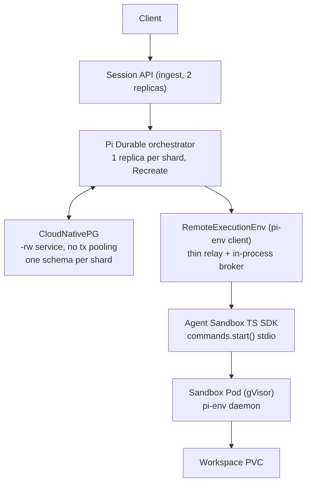

# cela: Self-Hosted Durable Pi Agents on Kubernetes (formerly pi-durable-k8s)

Status: proof of concept; phases 1 to 4c done. Results below are historical observations in one example test environment.
Scope: proof of concept. Production hardening is out of scope and listed at the end.

## 1. Goal

Run Pi Durable agents on your own Kubernetes cluster so that:

- agent state lives in PostgreSQL (CloudNativePG) and survives orchestrator restarts,
- tools run in a per-session gVisor sandbox with a persistent workspace PVC; remote MCP tools are the exception: the orchestrator calls them over HTTP through the OneCLI gateway, like the model, and never from the sandbox ([ADR 0007](docs/decisions/0007-native-remote-mcp.md)),
- sessions are reachable through a small remote API,
- missing pieces are contributed upstream instead of forked.

## 2. Decisions taken

| Decision | Choice | Reason |
|---|---|---|
| Durability layer | Native Pi Durable, no durable-harness | Single replica is enough; avoids the reference-grade Postgres World and the 120 s takeover trap |
| Storage | `@gscode1/pi-durable-postgres`: our fork of `@netzlabor/pi-durable-postgres`, ported to current Pi Durable and published to npm ([ADR 0033](docs/decisions/0033-own-adapter-package.md)) | The upstream adapter exists and passes conformance on 1.0.3; it needed the 1.5 batched-commit contract, and the port had no upstream review |
| Orchestrator topology | One replica per shard, `strategy: Recreate`; shard 0 is the default single orchestrator. More shards by Postgres schema sharding, one Deployment each (`docs/decisions/0017-schema-sharding.md`, `docs/scaling.md`) | Adapter allows one owner per schema (advisory lock); shards scale capacity without an adapter fork |
| Execution | `pi-env` daemon inside the sandbox, bridged over Agent Sandbox `commands.start()`. Since [ADR 0016](docs/decisions/0016-in-process-broker.md) the bridge runs in an in-process broker in the orchestrator and pi-env spawns only a thin `node:net` relay per session (this replaced one Node bridge process per session) | Conformance-tested `RemoteExecutionEnv`; avoids hand-writing FileSystem + Shell |
| Execution fallback | `pi-env` over SSH | Documented path if the stdio bridge fails |
| Sandbox | kubernetes-sigs/agent-sandbox, `runtimeClassName: gvisor`, `volumeClaimTemplates` | Lifecycle, PVC and reattach already exist |
| SDK connectivity | `in-cluster-service` | Port-forward mode does not work on gVisor |
| Interrupted commands | Report as interrupted; agent inspects workspace | Reattachment deferred until proven necessary |
| `@parcha/pi-transport` | Not used | Retired by its maintainers |
| Self-hosted Claude Managed Agents | Not used | Limited to Claude models; this project stays on Pi and model-agnostic |
| Isolation runtime | gVisor | Confirmed working in the target environment |

## 3. Architecture



Session mapping: one Pi conversation ID = one named SandboxClaim = one PVC (`pi-conv-<n>`, or `pi-s<k>-conv-<n>` on shard k). A **shard** is one orchestrator Deployment with its own Postgres schema; the **broker** is the in-process server that carries a session's pi-env stream to its sandbox.

## 4. Phases

### Phase 1: De-risk spikes (2–3 days)

1. **Stdio bridge.** Bake the `pi-env` daemon into a sandbox image. Start it with `commands.start()` and connect `RemoteExecutionEnv` through a custom `Connection`.
   - Exit: Pi Durable's env conformance suite passes against the sandbox.
   - If it fails: fall back to SSH and note what `commands.start()` lacks.
2. **Sandbox basics.** SandboxTemplate with gVisor, `spec.service: true`, PVC, dropped capabilities, no service-account token. Verify `getSandbox()` reattach after orchestrator restart and Pod recreation with the PVC intact.

**Phase 1 result (2026-11-15): done.** `tests/e2e/run-phase1.sh` is green on the example test cluster.
- The env conformance suite passes 29/29 through the bridge.
- Reattach works after an orchestrator restart and after Pod recreation, with the PVC intact.
- No in-cluster-service DNS staleness was seen for a fresh connection.

Findings that change this plan:
- pi-env's `Connection` only spawns a local argv, so the bridge is a local executable (`pi-sandbox-bridge`) that relays its stdio over `commands.start()`.
- A SandboxClaim must reference a SandboxWarmPool. A pool with `replicas: 0` works as a plain template alias.
- The SDK's `Sandbox.close()` deletes the claim. Use `closeLocal()` everywhere except on session deletion.
- Early tests used flannel without enforcement; later tests used Cilium. A policy-enforcing CNI is required before using real credentials.
- Stdio throughput is about 1.7 MiB/s in each direction. That is fine for tool calls, but large file transfers would need work.
- Still open: whether a long-lived connection survives Pod recreation, and whether SIGKILL reaps pi-env's child process groups (both Phase 3).

### Phase 2: Postgres storage (about 1 week)

1. Port the adapter to current Pi Durable: `Storage.commit(batches, receive, context)`, tightened `mintId`, watch changes.
2. Run the upstream storage conformance suite on PostgreSQL 17 via CloudNativePG.
3. Open a PR upstream to the adapter repo (done: https://github.com/j-koester/pi-durable-postgres/pull/20, from the fork https://github.com/gscode1/pi-durable-postgres).

- Exit: conformance green on the pinned Pi Durable version.
- Constraint: connect to the `-rw` service or a session-mode pooler only.

**Phase 2 result (2026-11-15): port done, upstream PR open (j-koester/pi-durable-postgres#20, awaiting review).**
- The port was consumed as a packed tarball under `vendor/` (version `0.2.0`) until 2026-11-18. Since [ADR 0033](docs/decisions/0033-own-adapter-package.md) it is the npm package `@gscode1/pi-durable-postgres`, pinned to an exact version. It started from upstream `e66d502`, which already targeted Pi Durable 1.1.0, not 1.0.3.
- The upstream storage conformance suite passes 32/32 on PostgreSQL 17, plus 32 adapter tests: lock, fail-closed on `pg_terminate_backend`, batched refusals, and the v2 migration. The contract diff is in that repo's `docs/port-1.5.md`.
- Schema migration v2 adds the `sleeping` status, and older adapter builds cannot open a migrated database.
- Watch/changes needs no storage work: conversation views and `observeCommits` live in Session/Harness.
- Still open: testing on real CNPG and a session pooler (Phase 3), TCP keepalive and statement timeouts against silent drops, and the upstream PR review.
- Chord 1.5.2 ships type errors under `exactOptionalPropertyTypes`. Report this upstream.

### Phase 3: Integration and failure tests (2–3 days)

Wire orchestrator, storage and sandbox together, then run:

| Test | Pass condition |
|---|---|
| Restart | Kill the orchestrator mid-task; the session resumes from Postgres without input |
| Double owner | Second orchestrator blocks on the lock; first fails closed when its DB connection drops |
| Long command | Kill the orchestrator during a 5-minute command; the tool returns interrupted, the process is dead in the sandbox, nothing reruns on its own |
| Sandbox loss | Delete the Pod; a new Pod mounts the same PVC and the next tool call works |
| Concurrency | Two sessions run in parallel with separate sandboxes and no cross-access |
| Isolation | Sandbox cannot reach the orchestrator, Postgres or other sandboxes (NetworkPolicy) |

**Phase 3 result (2026-11-15): done.** `tests/e2e/run-phase3.sh` ran twice in a row on the example test cluster: restart, double owner, long command, sandbox loss and concurrency pass; isolation is KNOWN-FAIL (flannel does not enforce NetworkPolicy; an in-sandbox probe reached the orchestrator, Postgres and another sandbox's sandboxd). The orchestrator is `packages/orchestrator` (scripted Pi faux model, no LLM); the adapter was then a packed tarball under `vendor/` (now an npm package, [ADR 0033](docs/decisions/0033-own-adapter-package.md)).
- Open questions answered. (1) SIGKILL of the remote stream: the command's process group and same-group descendants were reaped about 20 s after the orchestrator pod was killed, but a background child that called `setsid` survived. Interrupted commands can therefore leak escaped children until the sandbox is recycled (done: [ADR 0003](docs/decisions/0003-recycle-pod-on-interrupt.md)). (2) A long-lived `Connection` survives Pod recreation: the bridge dies with the stream, pi-env's `Connection` respawns it on the next call, and a call issued while the Pod was still being replaced also completed. No reconnect code was needed.
- The adapter refuses a second owner immediately instead of blocking, so the orchestrator waits in a retry loop (2 s) until it gets the lock. After `pg_terminate_backend` the first owner exits with code 1 at its next write (`fail-closed`), and `durable_metadata.next_seq` stayed frozen while the lock was held by the test.
- A tool that was running when the orchestrator died reads as `interrupted` after restart and is not replayed (`bash` is not replay-safe).
- Fix found by the concurrency test: each bridge is a Node process that needs about 12 s of wall time to cold-start on the orchestrator's 250m CPU limit. With several at once pi-env gave up with "connection timed out" (30 s of silence). `sandbox-env` now starts bridges one at a time (`StartGate`). A shared in-process broker would remove the per-session Node start; that is a later optimisation (done: [ADR 0016](docs/decisions/0016-in-process-broker.md); `StartGate` stays).

### Phase 4: Session API (several days)

- Endpoints: create session, submit message, steer, stream events, reconnect, delete.
- Build streaming on Pi Durable's conversation views (the older `watchEvents` was removed in 1.5).
- Authentication: OIDC or a static token for the PoC; per-session ownership check.
- Cleanup: delete the SandboxClaim and PVC on session deletion. The `shutdownAfterSeconds` backstop was dropped: an
  absolute deadline deletes the PVC. Idle sandboxes are suspended instead ([ADR 0004](docs/decisions/0004-idle-suspend.md)),
  and a periodic sweep removes what deletion missed ([ADR 0002](docs/decisions/0002-orphan-sweep.md)).

**Status 2026-11-17: done and running.** The session API is `packages/ingest` (stateless, 2 replicas, static tokens per owner in `PI_API_TOKENS`) in front of the orchestrator; `docs/session-api.md` is the contract. Since the first cut it gained, each with an ADR: model settings and an admin API in Postgres (0008), the MCP server catalog and native remote MCP tools (0007, 0009), versioned session profiles (0010), skills pinned in profiles and skills and `AGENTS.md`/`CLAUDE.md` read from the cloned repo (0011, 0014, 0015), schema sharding (0017). The e2e suites run in a throwaway namespace per run (0013).

### Security baseline for real use (from the plan review, 2026-11-15)

Requirement: a NetworkPolicy-enforcing CNI. The supplied Cilium policies also use FQDN egress rules. Verify isolation before using real credentials (4b/4c).

- **Policies:**
  - Ingress allow-lists for the orchestrator (from ingest only), Postgres (from orchestrator and ingest), and sandboxd (from the orchestrator).
  - Sandbox egress: OneCLI gateway, DNS, and direct public internet. Private, LAN and metadata ranges are excluded. This was decided 2026-11-15 so every session can install packages; Reversed for installs with the egress proxy on ([ADR 0038](docs/decisions/0038-network-modes.md)), which is the chart's default since 2026-11-19: a sandbox then reaches the proxy only, unless its profile opts into `networkMode: direct` behind `security.allowDirectSandboxEgress`. `egressProxy.enabled: false` keeps the old baseline.
  - In the `onecli` namespace, admit only the orchestrator and sandboxes.
- **Historical OneCLI v1.45 management API finding (2026-11-15):**
  - On the example test cluster, `onecli:10254/v1/agents` returns agents including their `accessToken`, and `/v1/secrets` returns metadata, with no authentication.
  - Protect any exposed dashboard and management routes as well as in-cluster access.
  - Require OneCLI authentication and protect ingress before using real credentials; v2 findings are below.
- **Gateway egress:** open by default since [ADR 0043](docs/decisions/0043-open-onecli-defaults.md) (any public host, RFC 1918 on 443 only, CGNAT, metadata and cluster-internal addresses refused); an explicit host allowlist (model APIs, github.com, package registries) with `toFQDNs` is opt-in hardening, and is installed instead when the release has no egress proxy. Deny cluster CIDRs and `*.svc` through CONNECT.
- **Per-sandbox sandboxd token (done, [ADR 0001](docs/decisions/0001-per-sandbox-sandboxd-token.md)):** token = HMAC-SHA256(master, claim); only its sha256 is injected per claim (SandboxClaim `spec.env`, template policy `Allowed`), replacing the shared secret. Master in Secret `sandboxd-auth` key `master`, orchestrator only; bridges get their own claim's token. Claims from before this need a one-time recreate.
- **Token handling:**
  - Treat session proxy tokens as readable by the agent.
  - Rely on grant scope, a short TTL and binding to the pod source IP.
  - Re-mint the token on each `ensure()`.
  - Recycle the Pod on interrupt, because `setsid` children escape. Done for every session, not only repo sessions
    ([ADR 0003](docs/decisions/0003-recycle-pod-on-interrupt.md)).
- **Least privilege for OneCLI:** a project-scoped OneCLI key or a separate provisioner, never an admin key in the orchestrator. Strip secrets from bridge env.
  Amended by [ADR 0042](docs/decisions/0042-onecli-admin-key-in-orchestrator.md): for the proof of concept the orchestrator keeps the admin key (and the GitHub App key) as an accepted risk, until OneCLI has scoped keys or the project goes multi-tenant.
- **Identity:**
  - Session IDs are UUIDs.
  - Claims carry the session label and are adopted only on a label match.
  - Each session stores an owner subject.
- **Lifecycle (done 2026-11-16, issue #9):**
  - No absolute `shutdownAfterSeconds` deletion of PVCs. An idle sandbox is **suspended** (`Sandbox.spec.operatingMode:
    Suspended`: Pod deleted, Sandbox, claim and PVC kept) after 30 minutes and resumed by the next tool call
    ([ADR 0004](docs/decisions/0004-idle-suspend.md)).
  - Write a workspace marker so a missing workspace is reported, not silently recreated.
  - Deletion writes a tombstone first, revokes the OneCLI agent first, and a periodic sweep reconciles claims, PVCs and
    agents against sessions ([ADR 0002](docs/decisions/0002-orphan-sweep.md)). The sweep removes only what belongs to a
    deleted or unknown session; an active session with a dead claim stays an operator decision.
  - An interrupted command (cancel, steer, timeout, orchestrator killed mid-command) gets its sandbox Pod replaced, never
    the claim or PVC ([ADR 0003](docs/decisions/0003-recycle-pod-on-interrupt.md)).
- **Spend:** a per-session turn and token budget, a concurrency cap, and a terminal `failed` state on 401/403 so a crash loop can't retry paid calls.
- **Inputs:** validate `{repo, branch}` (`owner/name` and ref regex, https only, argv with `--`). Clone into a temp dir, then rename.
- **Ops:**
  - Retention and caps on tool output. Configure database backups before production use.
  - A digest-pinned orchestrator image (the liveness probe is in the chart's `templates/orchestrator/deployment.yaml`).
  - Sandbox sizing per session, with ephemeral-storage limits.
  - Mount the OneCLI CA from a ConfigMap (`SSL_CERT_FILE`, `GIT_SSL_CAINFO`, `NODE_EXTRA_CA_CERTS`).
- **Capacity:** each session had its own Node bridge (about 12 s start, serialized, about 95 MiB). Since [ADR 0016](docs/decisions/0016-in-process-broker.md) (issue #59, slice 1) the bridge runs in an in-process broker and pi-env spawns only a thin `node:net` relay; measured 2026-11-17: 115-147 MiB idle orchestrator and about 11 MiB per open env, and the cap on open bridges is now derived from the memory limit ([ADR 0018](docs/decisions/0018-derived-bridge-cap.md), [scaling](docs/scaling.md), [metrics](docs/metrics.md)).

**Enforcement result (2026-11-16):**
- Cilium v1.20.4 runs with `enable-policy: default` and audit mode off, and all cela-dev endpoints enforce in both directions.
- The isolation test PASSES for real: orchestrator, Postgres, other sandboxes, the kube API and the OneCLI API/web are BLOCKED from a sandbox. The OneCLI gateway and public internet are reachable. (This run predates the egress proxy; with the proxy, the default since 2026-11-19, a sandbox reaches only the proxy, [ADR 0038](docs/decisions/0038-network-modes.md).)
- Phases 1, 3, 4 and 4b, including a real Codex run, are green under enforcement.
- Open:
  - Hubble is disabled.
- 2026-11-16: sandbox image `1.5.2-r2-5bccb47` pinned by digest; phase 4c run live on `<owner>/<repo-a>` and
  `<owner>/<repo-b>`: 5/5 PASS (clone, push and branch delete through OneCLI; push to the other repo refused).
- OneCLI ingress and egress policy example: `hack/onecli-policies/`. Apply it with your OneCLI deployment manager,
  then verify the dashboard, model, repository and isolation paths. An interactive dashboard login was not covered by the original run.

### Phase 4b: Credentials through OneCLI, and model selection

Decision: every credential goes through OneCLI. That covers model providers and GitHub. The manifests default to OneCLI in namespace `onecli`, with the gateway on :10255; adapt endpoints and policy selectors for your installation. Neither the orchestrator nor the sandboxes hold real secrets; they only hold OneCLI proxy tokens.

0. **OneCLI spike results** (`docs/research/onecli-spike.md`, deployed v1.45.0):
   - Works: subscription OAuth (`authMode: oauth`, auto-refresh), header injection, git with `-c http.proxyAuthMethod=basic`, Node `fetch` and pi-ai through the proxy (`NODE_USE_ENV_PROXY`, `NODE_EXTRA_CA_CERTS`, `NO_PROXY`).
   - Blocking:
     - The gateway is an open relay: any host, and in-cluster targets even without a token.
     - A request with no token is not rejected.
     - No native per-repo scope. The workaround is a per-session secret with `pathPattern:/owner/repo*`.
     - No token TTL or source binding; tokens can only be rotated or deleted.
     - The management API has no auth.
   - **Upgraded to v2.20.0 (2026-11-15, pinned by digest; `docs/research/onecli-v2-recheck.md`):**
     - Fixed: a request with no token gets 407. Private, cluster and metadata targets are always refused. The management API needs auth (API key `oc_…`).
     - Still open:
       - Public hosts are relayed unless there are explicit `allow …` then `block *` rules; add them.
         Done 2026-11-16 (`hack/onecli-host-rules.sh --apply`; probes in `docs/onecli-host-rules.md`).
       - No repo scoping without an enterprise license; GitHub connections inject an account-wide token, and path rules can be bypassed. So use our own repo-scoped GitHub App installation token per session, never a OneCLI GitHub connection.
       - No token TTL or source binding. Mitigate with a short session lifetime, rotate on `ensure()`, and delete on session end.
       - Sign-up is open and email/Google are the only login options.
     - The API is now `onecli.onecli:10256`; the proxy is unchanged on `:10255`. Keep `http.proxyAuthMethod=basic` for git (not re-tested on v2).
1. **Spike first.** Answer each of these, and stop on a no:
   - Does OneCLI inject the ChatGPT/Codex subscription (OAuth) for model calls, or only API keys?
   - Does `git clone` and `git push` to github.com over HTTPS get credentials injected?
   - Can a grant be scoped to one repo?
   - How do we deliver a per-session proxy token to that session's commands only, and can the gateway bind it to the pod's source IP?
   - What does the gateway forward (any host, or an allowlist), and can it deny in-cluster targets?
   - Does pi-ai work through the proxy with dummy credentials (`NODE_USE_ENV_PROXY` or a dispatcher; `NO_PROXY` for the cluster)?
2. **Orchestrator.**
   - The orchestrator is a OneCLI agent with grants for model providers only.
   - pi-ai model calls go through `HTTPS_PROXY` plus the OneCLI CA.
   - Only `ONECLI_API_KEY` (for managing agents and grants) lives in a Secret, delivered with ExternalSecret.
3. **Model choice.**
   - The default `PI_MODEL_PROVIDER` / `PI_MODEL_ID` comes from a ConfigMap. `scripted` keeps the fake model for e2e. (Superseded by [ADR 0008](docs/decisions/0008-settings-in-postgres.md): the ConfigMap only seeds Postgres, and the default, allowlist and reasoning change through `PUT /admin/settings`; session profiles, [ADR 0010](docs/decisions/0010-session-profiles.md), pick tools, instructions, MCP servers and skills per session.)
   - `POST /sessions` takes an optional `{ provider, model }`, checked against an allowlist.
   - Verify whether Pi Durable 1.5.2 persists the model per conversation.
4. **Fallback.** If the spike shows OneCLI can't do subscription OAuth, use our own credential store as described in `docs/model-credentials.md`.

**Result (2026-11-15):** OpenAI Codex subscription works through OneCLI v2.20: `gpt-6.1-terra` (default, reasoning `medium`) and `gpt-6.1-sol` answered after a sandbox tool call, no provider key in the orchestrator; revoking the grant fails the session cleanly and restoring it works (`docs/model-credentials.md`).

Tests:
- A model call works with no provider key in the orchestrator env.
- Two sessions use different models.
- A disallowed model is rejected with 400.
- Revoking the OneCLI grant fails the session with a clear error.

### Phase 4c: Optional repository workspace (via OneCLI)

- `POST /sessions` takes an optional `{ repo, branch }`. Without it, `/workspace` stays empty and no OneCLI agent is created.
- With a repo:
  - The orchestrator creates a OneCLI agent per session with only the GitHub connection grant, scoped to exactly that repo. OneCLI v2 can't do this, so the orchestrator mints the token itself with the user's existing GitHub App (the one OneCLI's connection uses), using an extra private key kept in `secret-store` and exposed by an ExternalSecret to the orchestrator only. It calls `POST /app/installations/{id}/access_tokens` with `repositories:[repo]` and minimal `permissions` (contents, pull_requests). The result is a 1 h token, stored as that session's OneCLI secret (hosts github.com and api.github.com) and re-minted before expiry. Session agents never get a grant for the OneCLI GitHub connection, because it gives account-wide access. Branch protection is the repository owner's: protect `main` and release branches with GitHub's own rules, without the App as a bypass actor (`docs/repo-workspace.md`, ADR 0027).
  - It passes the proxy token, `HTTPS_PROXY` and the CA to that session's commands.
  - It clones into `/workspace` once; the clone is idempotent and skipped if `.git` exists.
- Session delete also deletes its OneCLI agent.
- The sandbox image adds git and CA certificates. (Since issue #318 it also ships Node, Python, build tools, uv, curl, jq, yq, ripgrep, fd, sqlite3, shellcheck, git-lfs and gh: [docs/sandbox-image.md](docs/sandbox-image.md), ADR 0048.)
- Once NetworkPolicy is enforced, sandbox egress is only the OneCLI gateway (plus DNS). (Superseded twice: first by the 2026-11-15 baseline above, direct public internet open; then by the egress proxy (epic #50, ADRs 0034–0041), the chart's default since 2026-11-19: a sandbox reaches only the proxy, which applies the profile's rules and routes credentialed hosts to OneCLI.)
- Tests:
  - A session without a repo works unchanged.
  - The clone happens once and survives a restart.
  - A private repo can be cloned and pushed to.
  - No GitHub token is readable in the sandbox.
  - The token for repo A cannot reach repo B, and is rejected from another pod's IP.

### Phase 5: Upstream (ongoing)

1. Postgres adapter port (Phase 2).
2. Example or docs for "Pi Durable orchestrator outside, tools inside" in agent-sandbox, next to the existing Pi-in-sandbox example.
3. Later, only if tests show the need: detached, reattachable processes in sandboxd.

### Phase 6: Installation (planned, issue #104)

One install path on any cluster: Helm releases behind `hack/install.sh` (app chart, bundled Postgres instead of
CloudNativePG, bundled OneCLI and agent-sandbox, each optional), gVisor by default with runc for tests, warn-only network
policy with an isolation probe, and a one-command kind install. Stacks made from the old kustomize `deploy/` directory (removed in slice 11b) are reinstalled, not migrated,
and the CNPG operator is never touched. Plan, slices and acceptance checks: [install-plan.md](docs/install-plan.md);
decision: [ADR 0020](docs/decisions/0020-helm-install.md).

## 5. Security baseline for the PoC

- NetworkPolicy: only the orchestrator may reach sandboxd; default-deny egress from sandboxes with an explicit allowlist.
- `sandboxd.authToken` set per sandbox (HMAC of a master key per claim, [ADR 0001](docs/decisions/0001-per-sandbox-sandboxd-token.md)). Traffic is plaintext in-cluster, so the NetworkPolicy is the control.
- Model credentials stay in the orchestrator; never mounted into sandboxes.
- Sandboxes run non-root with all capabilities dropped.

## 6. Risks

| Risk | Impact | Mitigation |
|---|---|---|
| Pi Durable breaking releases every few weeks | Repeated porting; no rollback across state migrations | Pin exact versions; upgrade deliberately; back up before each upgrade |
| Agent Sandbox TS SDK is private and unversioned | API drift | Vendor at a pinned commit; isolate behind one module |
| Stdio bridge unproven | Phase 1 slips | SSH fallback. Proven in Phase 1 (conformance 29/29); the SSH fallback was not needed |
| One replica per shard | Downtime of a shard's sessions during its restart | Accepted for the PoC; other shards keep running. Capacity: add a shard (`orchestrator.shards`). Takeover or leader election later |
| Non-idempotent external tools | Duplicate side effects after a crash | Mark tools `replay` correctly; add execution IDs for external APIs |
| gVisor I/O overhead on PVCs | Slow builds | Measure in Phase 3; consider Kata if unacceptable |
| Inbox drain transaction stays open for the whole repo preparation (about 96 s) | Row locks held, one pool connection per busy session; migrations used to queue behind it and crash-loop ingest | Migrations skip DDL when current and fail fast on locks, ingest serves `/healthz` first (`docs/decisions/0005-migrations-without-ddl-locks.md`); repo preparation now runs before the inbox claim, outside the drain transaction (#75) |

## 7. Out of scope for the PoC

- Active/active orchestration and HA: capacity scales by shards ([ADR 0017](docs/decisions/0017-schema-sharding.md)), but each shard is one replica and sessions do not move between shards.
- Process reattachment.
- Warm pools (PVC-backed sandboxes start cold; the SandboxWarmPool has `replicas: 0` and is only a template alias).
- Encryption in transit to sandboxd, audit logging, retention, backup policy.
- A user-facing web UI for sessions (the admin console under `/console/` is for operators, [plan](docs/admin-ui-plan.md)).

## 8. Effort

About 2–3 weeks part-time to a working PoC. This is an estimate, not a measurement; Phase 1 will show whether it holds.

## 9. Open questions

- Is `commands.start()` stdio binary-clean and unbuffered enough for pi-env's framed protocol? (Answered yes, Phase 1.)
- Does the adapter maintainer want the 1.5 port, or is a fork needed? (Answered 2026-11-18, [ADR 0033](docs/decisions/0033-own-adapter-package.md): we do not wait. The fork https://github.com/gscode1/pi-durable-postgres publishes `@gscode1/pi-durable-postgres` to npm and this repo consumes that. The upstream proposal https://github.com/j-koester/pi-durable-postgres/pull/20 stays open.)
- Which Pi Durable version to pin: 1.5.x now, or wait for the churn to slow? (Pinned 1.5.2.)
- Is `in-cluster-service` DNS staleness after Pod recreation a problem in practice? (Not seen, Phase 1 and 3.)

## 10. Repository layout

Split by where the code ends up, not by phase.

| Repo | Contents | When |
|---|---|---|
| Fork of `pi-durable-postgres` (`gscode1/pi-durable-postgres`) | Port to current Pi Durable, published to npm as `@gscode1/pi-durable-postgres`; also proposed upstream (PR #20 open) | Phase 2 |
| Main repo `cela` (own) | Orchestrator, pi-env bridge, session API, sandbox image, manifests, tests | Phase 1 onward |
| Fork of `agent-sandbox` | Example or sandboxd change | Phase 5, only when contributing |

The main repo consumes the adapter fork as a pinned npm dependency (exact version).

Main repo layout:

```
packages/
  sandbox-env/      # pi-env bridge over commands.start(): broker, relay, start gate
  orchestrator/     # Pi Durable host, sandbox lifecycle, one process per shard
  ingest/           # session API (stateless HTTP front, 2 replicas)
  mcp/              # stdio MCP adapter for coding agents, a session-API client only (ADR 0031)
  session-core/     # shared schema, migrations, settings, profiles, skills, MCP catalog, auth
  egress-proxy/     # Go: the egress proxy, Smokescreen with rules from Postgres and a OneCLI route (ADRs 0034–0041)
  browser-proxy/    # loopback forwarder in the browser sandbox (ADR 0041)
  admin-ui/         # admin console, served by ingest under /console/
  vendor/           # Agent Sandbox TS SDK, built from a pinned commit
charts/             # cela (app), pi-postgres (bundled database), pi-onecli (bundled gateway)
hack/               # install.sh, kind scripts, operator scripts (secrets, OneCLI CA and host rules), onecli-policies/
images/             # build.sh, orchestrator/, ingest/, sandbox/ (pi-env daemon), sandbox-browser/, e2e-driver/, egress-proxy/
docs/               # API, scaling, metrics, e2e, decisions/ (ADRs)
examples/           # recorded load-test and bug-hunt runs
tests/e2e/          # restart, double-owner, long-command, sandbox-loss and more; run.sh <smoke|phase1|phase3|phase4|phase4b|phase4c|mcp|shards|browser|console|all> runs them as an in-cluster Job in a fresh namespace pi-e2e-<id> (docs/e2e.md)
```

Extract `sandbox-env` into its own package once it passes the env conformance suite; it is the piece most useful to others.

## References

- Pi Durable: https://github.com/earendil-works/pi/tree/main/packages/durable
- pi-env: https://www.npmjs.com/package/@earendil-works/pi-env
- pi-durable-postgres: https://github.com/j-koester/pi-durable-postgres
- Agent Sandbox TypeScript client: https://agent-sandbox.sigs.k8s.io/docs/typescript-client/
- Agent Sandbox releases: https://github.com/kubernetes-sigs/agent-sandbox/releases
- Self-hosted Claude Managed Agents (rejected option, reference architecture): https://platform.claude.com/docs/en/managed-agents/self-hosted
- durable-harness self-hosting (rejected option): https://vercel.com/docs/agent-harnesses/self-hosting


### Image delivery (installation slice 2, issue #107)

`images/build.sh` builds orchestrator, ingest, sandbox and e2e-driver for linux/amd64 and linux/arm64. App images
include workspace dependencies, vendored code and SQL migrations; the driver includes its scripts and Phase 1 tests.
Deployments use built images instead of runtime code uploads. Every shard Deployment uses the chart's image values and needs no
shared-code node affinity. Build/push images explicitly, then set the digests in your values file as described in
[image builds](images/README.md), the [chart README](charts/cela/README.md) and [e2e](docs/e2e.md).
